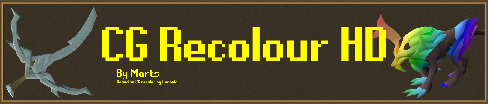
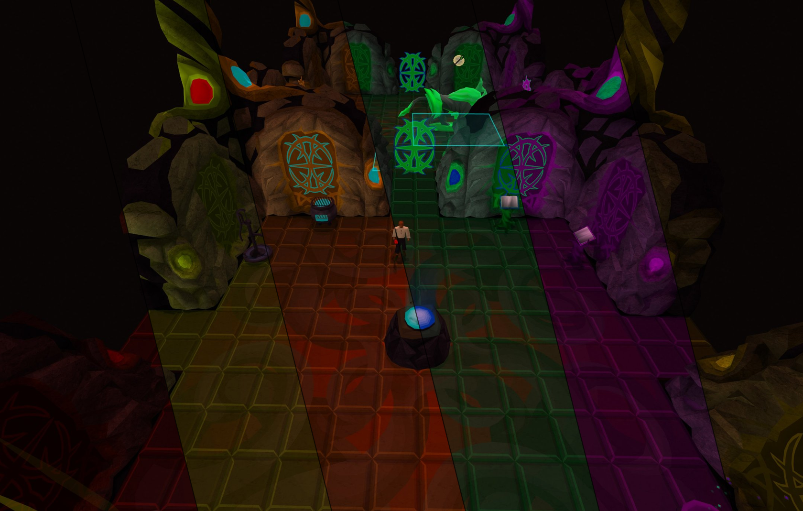
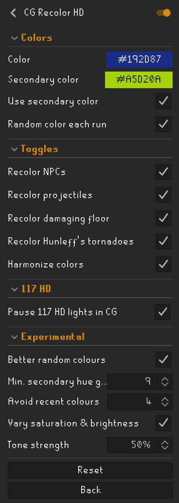

# CG Recolor HD

Recolour the Corrupted Gauntlet in any colour you like, now working alongside 117 HD.

This plugin is based on [CG recolor](https://github.com/denaelc/gauntlet-recolor) by Denaelc, which does all of the actual recolouring. The original can't be used with 117 HD: switching it on turns 117 HD off. I play with 117 HD and was sorely missing it in the red prison, so I made this version with 117 HD support and a few extra options for random colours. All credit for the recolouring itself goes to Denaelc.

## Features

### Recolouring

Everything red in the Corrupted Gauntlet can be recoloured:

- **Walls, floors and objects:** the rooms, resource nodes, the range, the singing bowl and the rest of the Corrupted Gauntlet, plus its entrance in the lobby
- **NPCs:** the Corrupted Hunllef and every corrupted creature
- **Projectiles:** the Hunllef's attacks and other NPC projectiles
- **Damaging floor:** the tiles that hurt you during the Hunllef fight
- **Tornadoes:** the Hunllef's tornadoes

NPCs, projectiles, the damaging floor and tornadoes can each be switched off if you'd rather keep them red. The normal Gauntlet isn't changed.

### Colours

- **Color:** the main colour for the Gauntlet
- **Secondary color:** an optional second colour for the brightest, glowing parts
- **Random color each run:** a new colour every time you go back to the lobby
- **Harmonize colors:** gives everything exactly the same hue, for a more unified look. Turn it off to keep some of the natural variation between surfaces. The damaging floor is never harmonized, so it always stays easy to see.

### 117 HD support

117 HD gives the corrupted NPCs and many of the objects in the Corrupted Gauntlet a bright red glow. These glows are built into 117 HD and ignore any recolour, so a blue Gauntlet would still glow red.

With **Pause 117 HD lights in CG** on (the default), this plugin turns off 117 HD's **NPC lights** and **Object lights** while you're inside the Corrupted Gauntlet, then puts your own 117 HD settings back as soon as you leave. Your settings are remembered even if the client closes while you're inside, and are put back the next time you log in outside the Gauntlet.

This plugin only changes those two 117 HD settings, and only while you're inside the Corrupted Gauntlet. If you don't use 117 HD, it does nothing.

### Experimental

New options that aren't in the original plugin. They're all off by default, so the plugin works exactly like the original until you turn them on.

- **Better random colours:** random mode picks one of the game's 63 different hues, spread evenly, with strong saturation. Without it, random mode picks any colour at all, which often comes out greyish and makes many runs look alike.
- **Min. secondary hue gap:** with better random colours, how far apart the main and secondary colours must be, so you never get two that look nearly the same.
- **Avoid recent colours:** with better random colours, won't pick a colour close to any of your last few runs.
- **Vary saturation & brightness:** normally only the hue of your colour is used on most surfaces. This also carries over some of its saturation and brightness, so a pale, a vivid and a dark version of the same colour all look different. **Tone strength** sets how strongly. The damaging floor is left alone.

For the most variety, turn on **Random color each run**, **Use secondary color**, **Better random colours** and **Vary saturation & brightness**, and turn off **Harmonize colors**.

## Limitations

- **Corrupted Gauntlet only.** The normal Gauntlet is left as it is.
- **Items aren't recoloured.** Your corrupted weapons and armour stay their normal colours.
- **117 HD's area tint.** 117 HD gives the Corrupted Gauntlet a slightly pink-red ambient light, which this plugin can't change. It's most noticeable on the floors.
- **117 HD textures.** 117 HD chooses some of its textures by matching the Gauntlet's original colours, so a few recoloured crystal faces may get a different texture than usual.
- **117 HD settings while inside.** If you change 117 HD's NPC lights or Object lights by hand while you're in the Corrupted Gauntlet, your change is replaced by your old setting when you leave.
- **Changing settings reloads the area.** The recolour is applied as the area loads, so changing a setting causes a quick loading screen.
- **Turning the plugin off.** Some models may keep their new colours until you log out and back in. You'll get a chat message reminding you.
- **Avoid recent colours** only remembers runs since the client was opened.
- **Experimental options** can look odd with some colours, especially very dark or very pale ones.

## Configuration

**Colors**

| Setting | Default | What it does |
| --- | --- | --- |
| Color | Blue | The main colour for the Corrupted Gauntlet |
| Secondary color | Lime | The colour for the brightest, glowing parts |
| Use secondary color | On | Uses the secondary colour. Off uses the main colour everywhere |
| Random color each run | Off | Picks a new colour each time you go back to the lobby |

**Toggles**

| Setting | Default | What it does |
| --- | --- | --- |
| Recolor NPCs | On | Recolours the Hunllef and the corrupted creatures |
| Recolor projectiles | On | Recolours NPC projectiles |
| Recolor damaging floor | On | Recolours the floor tiles that hurt you during the Hunllef fight |
| Recolor Hunleff's tornadoes | On | Recolours the tornadoes |
| Harmonize colors | On | Gives everything the same hue for a unified look |

**117 HD**

| Setting | Default | What it does |
| --- | --- | --- |
| Pause 117 HD lights in CG | On | Turns off 117 HD's NPC lights and Object lights while you're in the Corrupted Gauntlet, and puts them back when you leave |

**Experimental**

| Setting | Default | What it does |
| --- | --- | --- |
| Better random colours | Off | Random mode picks evenly spread, strong hues |
| Min. secondary hue gap | 16 | How far apart (out of 64 hues) the main and secondary colours must be. 4 to 32 |
| Avoid recent colours | 4 | Won't pick a colour close to this many previous runs. 0 turns it off |
| Vary saturation & brightness | Off | Carries some of the colour's saturation and brightness onto surfaces |
| Tone strength | 50% | How strongly saturation and brightness are carried over |

## Issues and support

Found a bug or have an idea? Please [open an issue](../../issues/new) on GitHub. To help me fix a bug quickly, include:

- what you did, what you expected and what happened instead
- whether you use 117 HD, and which colour settings you had on
- a screenshot if you can

You can also see [existing issues](../../issues) to check whether it's already been reported.

## Credits

The recolouring, the Gauntlet's model colour data and the original settings are the work of Denaelc, from [CG recolor](https://github.com/denaelc/gauntlet-recolor). This version adds 117 HD support and the experimental options. If you don't use 117 HD, the original plugin is on the Plugin Hub as **CG recolor**.

## License

[BSD 2-Clause](LICENSE), as the original. The plugin icon is the [Corrupted Hunllef icon](https://oldschool.runescape.wiki/w/File:Corrupted_Hunllef_icon.png) from the OSRS Wiki, recoloured. The banner's lettering uses the [RuneScape UF](https://www.dafont.com/runescape-uf.font) font by Nathan P (nayfan), licensed [CC BY-ND 3.0](https://creativecommons.org/licenses/by-nd/3.0/).
